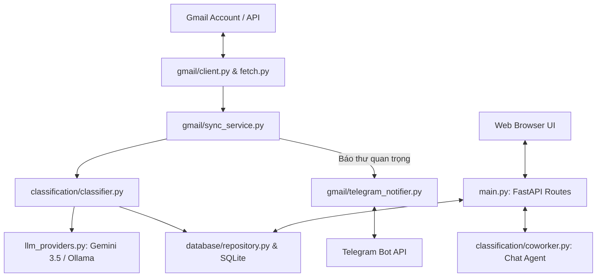

# Gmail Optimizer — Codebase Architecture & Technical Documentation

Tài liệu tổng hợp kiến trúc hệ thống, cấu trúc thư mục, luồng dữ liệu (Workflow) và chi tiết các module trong dự án **Gmail Optimizer (Inbox Intelligence System)**.

---

## 🏗️ 1. Kiến Trúc Tổng Quan (System Architecture)

Hệ thống được thiết kế theo kiến trúc **Full-stack Decoupled (FastAPI + Web UI + Multi-LLM Engine + SQLite + Telegram Bot)**.



---

## 📁 2. Cấu Trúc Thư Mục & Vai Trò Các File (Directory Structure)

```text
Gmail optimizer/
├── config.py                   # Đọc biến môi trường (.env) và định nghĩa Settings
├── main.py                     # Entry point chính của FastAPI server & các REST API endpoints
├── sync_cli.py                 # Script CLI để tự động sync email từ dòng lệnh
├── gmail_intelligence.db       # Cơ sở dữ liệu SQLite lưu trữ email & kết quả phân loại
├── .env                        # File cấu hình chứa API Key, OAuth credentials, Mode (Live/Dry)
│
├── classification/             # 🧠 MODULE XỬ LÝ AI & PHÂN LOẠI EMAIL
│   ├── classifier.py           # Bộ não phân loại chính (kết hợp Rules + LLM + Confidence)
│   ├── coworker.py             # Agent xử lý hội thoại Chat (Prompt engineering, Briefing)
│   ├── label_map.py            # Quy đổi kết quả AI thành nhãn Gmail tương ứng (Priority/Category)
│   └── llm_providers.py        # Adapter kết nối Gemini API cloud & Ollama local LLM
│
├── database/                   # 💾 MODULE DỮ LIỆU (ORM & REPOSITORY)
│   ├── db.py                   # Khởi tạo kết nối SQLite & SessionLocal
│   ├── models.py               # Định nghĩa các bảng SQLAlchemy (emails, classifications, feedback, sync_state)
│   └── repository.py           # Các truy vấn DB (CRUD, thống kê Dashboard, lọc email)
│
├── gmail/                      # 📧 MODULE TƯƠNG TÁC GMAIL API & TELEGRAM
│   ├── auth.py                 # Quản lý OAuth 2.0 (Token, Credential, Google Login)
│   ├── client.py               # Wrapper gọi Gmail API (gửi label, archive, fetch)
│   ├── fetch.py                # Parse email thô từ Gmail API (Header, Plaintext, Attachments)
│   ├── labels.py               # Quản lý danh sách nhãn Gmail (Tạo nhãn mới, gán nhãn)
│   ├── sync_service.py         # Dịch vụ đồng bộ Hòm thư (Sync loop + gọi Classifier)
│   └── telegram_notifier.py    # Gửi thông báo & Lắng nghe tin nhắn 2 chiều qua Telegram Bot
│
└── dashboard/                  # 🎨 GIAO DIỆN NGUYÊN KHỐI (WEB FRONTEND)
    ├── templates/              # HTML Templates (Jinja2)
    │   ├── index.html          # Trang Dashboard chính (Topbar 5 tabs: Chat, Inbox, Review, Overview, Settings)
    │   └── login.html          # Trang đăng nhập Google OAuth
    └── static/                 # Static Assets
        ├── css/style.css       # Design System (Inter font, Google palette, Light mode premium)
        └── js/
            ├── app.js          # Xử lý Tabs, Stats, Auto-sync background, Change & Teach Modal
            └── chat.js         # Xử lý giao diện Chat, Render Markdown (marked.js)
```

---

## ⚙️ 3. Quy Trình Hoạt Động Chi Tiết (Core Workflows)

### 3.1. Luồng Đồng Bộ & Phân Loại Email (Sync & Classify Workflow)
1. **Lấy mail**: `sync_service.py` gọi `GmailClient.get_messages()` kéo mail chưa phân loại về.
2. **Tiền xử lý**: `fetch.py` bóc tách thông tin `From`, `Subject`, `Body_plain`, `Date`.
3. **Phân loại (Classification)**:
   - `classifier.py` chạy qua **Heuristics (Bộ quy tắc từ khóa)** trước.
   - Nếu chưa đạt độ tin cậy $\rightarrow$ gọi `llm_providers.py` (Gemini `gemini-3.5-flash`).
   - Phân tích ra `Priority` (`URGENT`, `IMPORTANT`, `NORMAL`, `LOW`), `Category` (`WORK`, `CAREER`, `FINANCE`,...), và điểm `Confidence`.
4. **Lưu DB & Gắn nhãn**:
   - Lưu kết quả vào cơ sở dữ liệu `gmail_intelligence.db`.
   - Nếu `DRY_RUN=False` $\rightarrow$ Tự động gắn nhãn trực tiếp lên Gmail của người dùng.
5. **Cảnh báo Telegram**: Nếu thư rơi vào `IMPORTANT` hoặc `URGENT` $\rightarrow$ `telegram_notifier.py` phát tin nhắn báo ngay về điện thoại qua Telegram.

---

### 3.2. Luồng Học Theo Người Dùng (Few-Shot Feedback Learning)
1. Người dùng thấy thư phân loại chưa chuẩn $\rightarrow$ Chọn **Change & Teach** trên trang **Review** hoặc **Chat**.
2. Hệ thống gọi `POST /api/feedback` để cập nhật nhãn mới và lưu bản ghi vào bảng `user_feedback`.
3. Những lần phân loại tiếp theo, `classifier.py` lấy lịch sử từ bảng `user_feedback` làm ví dụ mẫu (Few-shot prompts) gửi kèm cho Gemini để AI tự học theo gu của bạn!

---

## 🔌 4. Danh Sách Các REST API Endpoints

| Method | Endpoint | Mô tả |
|---|---|---|
| `GET` | `/` | Đăng nhập/Render giao diện chính Dashboard |
| `GET` | `/login` & `/logout` | Đăng nhập & Đăng xuất Google OAuth 2.0 |
| `GET` | `/api/stats` | Lấy số liệu tổng quan (Processed, Important, Action, Urgent, Review) |
| `GET` | `/api/review` | Danh sách email cần người dùng xem xét/quyết định (`Confidence < 90%`) |
| `GET` | `/api/important` | Danh sách email quan trọng trong ngày |
| `POST` | `/api/sync` | Kích hoạt đồng bộ hòm thư Gmail |
| `POST` | `/api/chat` | Gửi câu hỏi cho AI Agent hỗ trợ hòm thư |
| `POST` | `/api/feedback` | Gửi phản hồi sửa nhãn (Change & Teach) để AI học |
| `POST` | `/api/mode` | Chuyển đổi trạng thái giữa **Dry Run** và **Live Mode** |

---

## 🛠️ 5. Hướng Dẫn Khởi Chạy Hệ Thống

### 5.1. Khởi chạy Server Web & Background Services
Bạn có thể khởi chạy ứng dụng bằng 1 trong 2 câu lệnh đơn giản tại thư mục gốc:

```bash
# Cách 1: Chạy trực tiếp bằng Python
python main.py

# Cách 2: Chạy qua Uvicorn server
uvicorn main:app --reload --port 8000
```
Truy cập giao diện tại: `http://localhost:8000`

---

## 📝 6. Các Điểm Đã Được Khắc Phục (Bug Fixes Summary)
1. **Lỗi tự động gửi câu hỏi "Thư nào quan trọng?" khi vừa F5 trang**:
   - Đã gỡ bỏ lệnh tự gửi trong `chat.js` để tránh tạo ra dòng tin nhắn dài bất ngờ mỗi lần bạn tải lại trang web.
2. **Lỗi định dạng Markdown thô (`**bold**`, `* list`)**:
   - Đã tích hợp `marked.js` chuyển toàn bộ tin nhắn AI sang định dạng HTML rõ ràng, dễ đọc.
3. **Lỗi Model Gemini API `ClientError 404`**:
   - Đã cập nhật `GEMINI_MODEL` mặc định sang `gemini-3.5-flash` tương thích hoàn toàn với Google Cloud API mới nhất.
4. **Bật Live Mode trực tiếp trên UI**:
   - Đã bỏ `disabled` trên công tắc UI Settings và tạo API `/api/mode` cập nhật file `.env` theo thời gian thực.
